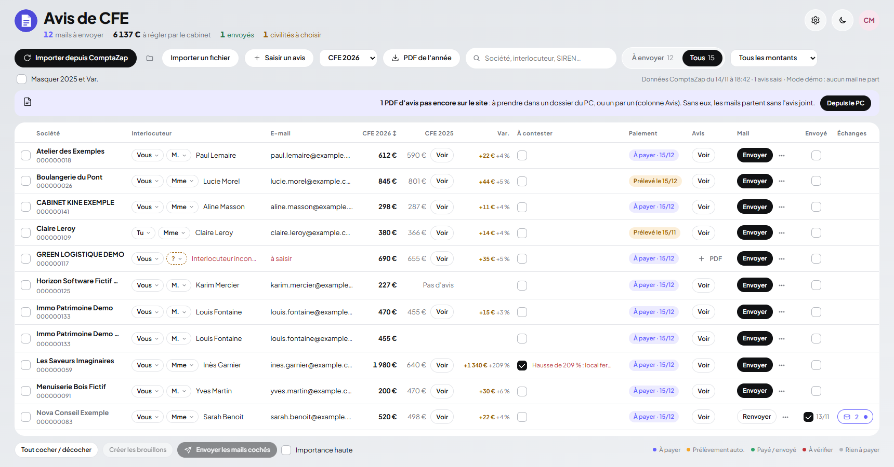
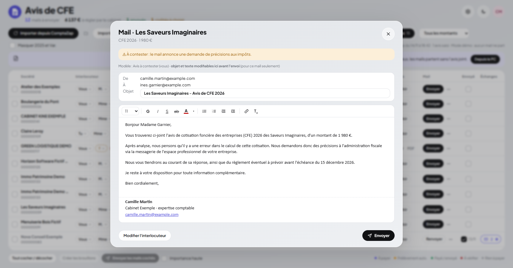
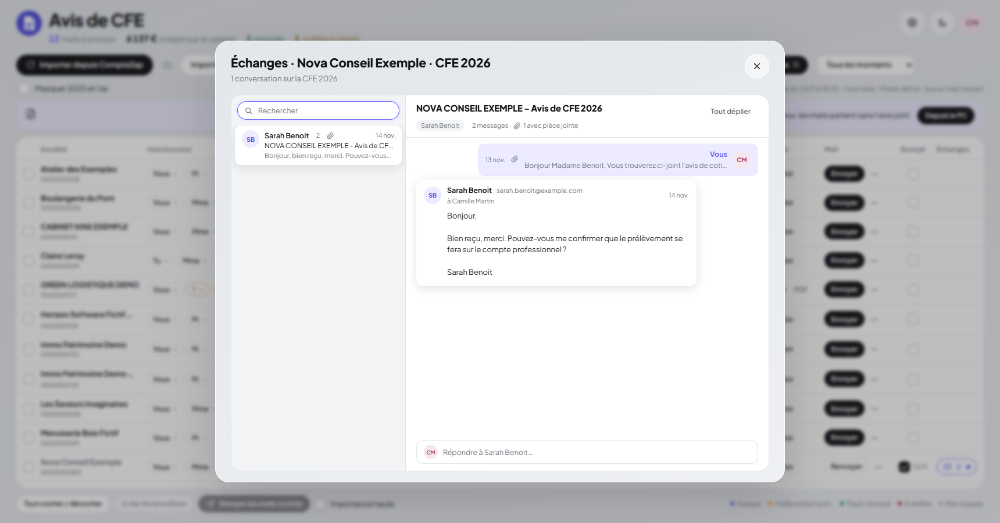

# Avis de CFE

Every autumn, French companies receive their CFE notice (the local business property tax), and their accountant has to forward it.
In a small firm that means dozens of PDFs to send in a few weeks, each with a different email: some clients are on direct debit,
some pay online, the firm pays for others, some notices are at 0 €, and a few look wrong and need to be contested.
Deadlines are close (mid-December), and you have to remember who already got their notice.

I built this tool so the whole campaign fits in one table.

| Email ready to send | Replies from clients |
|---|---|
|  |  |

## What it does

- For each client, it reads the notice, its payment status and any open debt on the tax account, matched by the notice reference.
  So it knows if the notice is still to pay, paid, partly paid, on direct debit, at 0 €, or needs checking.
- It shows this year next to last year (amount and variation), so a big increase stands out before the email goes.
- It writes the right email for each case: direct debit, "the firm will pay it unless you tell us otherwise", nothing to pay,
  or "we think there is a mistake, we asked the tax office". Formal or informal (vous / tu), editable before sending, notice attached.
- It tracks what was sent (found in Outlook's sent items, or ticked by hand) and shows the email threads with each client.
- It files the PDFs in each client's folder on SharePoint / OneDrive, and never overwrites a file that is already there.

The notices come from ComptaZap (its local database is read in the browser with sql.js, nothing is installed),
or from a CSV / Excel file, or are typed in. Client contacts come from Pennylane, a CSV file, or are entered on each row.
It works with or without ComptaZap, Outlook, SharePoint and Pennylane: without Outlook, each email downloads as an .eml with the
notice attached (or opens in your mail app) and you tick "sent" yourself; without SharePoint, you download the PDFs.

I wrote it in plain PHP 8 and JavaScript, without a framework, so it runs on basic shared hosting or on one PC.

## Try it

You need PHP 8.2+ with the `dom`, `mbstring` and `openssl` extensions. No account, no internet.

- Windows: `demo.bat`
- macOS / Linux: `./demo.sh`

Then open http://127.0.0.1:8103 (login `demo` / `demo`). The demo has 15 fake notices for invented companies.
Microsoft 365 and Pennylane are switched off, and sending is simulated.

## Use it for real

1. Copy `config.exemple.json` to `config.json` and set your firm name and the user accounts. Everything else is optional.
2. Run `php outils/initialiser.php`: it creates the accounts and prints a temporary password for each.
3. Point the web root to `public/` (or run `php -S 127.0.0.1:8080 -t public public/routeur.php` on one PC).
4. Optional: add your Microsoft Entra app id (Outlook, SharePoint) and your Pennylane firm id, then connect them in Settings.
5. Import your notices (ComptaZap, or a file like `exemples/avis-cfe-exemple.csv`) and your contacts (`exemples/interlocuteurs-exemple.csv`).

## Tests

`pip install pytest requests cryptography` then `python -m pytest tests -q`.
They run the real PHP server against fake Microsoft, SharePoint and Pennylane servers, plus a second server with nothing connected,
and check that the demo starts without calling anything outside.

## Limits

- Data is stored in JSON files. Fine for a small firm, not for hundreds of users.
- Microsoft 365 and Pennylane are only tested against simulated servers in this repo.
- The ComptaZap import depends on its database layout, which may change between versions.
- Matching a client to its contact and folder is done by company name, so odd names sometimes need a manual pick.

The interface is in French, since it was made for a French firm.

MIT licence. Made by Mehdi Mobtahij.
